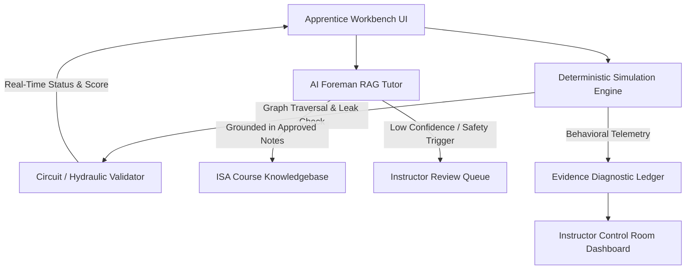

# AI Workshop Twin (ISA Edition)
> **"Make 20 mistakes in a virtual workshop before making one in a real workshop."**

[](https://nextjs.org/)
[](https://www.typescriptlang.org/)
[](https://tailwindcss.com/)
[](https://ai.google.dev/)
[](https://imperialskills.co.uk)

Built specifically for **Imperial Skills Academy (ISA)** to bring multimodal AI and deterministic simulation into beginner electrical and plumbing vocational education.

---

## ⚡ What Makes This Unique (Not Generic AI)

Most educational apps are generic SaaS templates with pastel gradients and chatbots that hallucinate technical instructions. **AI Workshop Twin** is engineered differently:

1. **Industrial Blueprint Aesthetic ("Night Workshop")**:
   - Technical blueprint grids, riveted cards, voltage meter bars, knife breaker toggles, and safety stamp badges.
   - High-contrast dark workshop styling engineered for vocational labs, academy tablets, and rugged shop displays.
2. **Deterministic Rules for Safety Decisions**:
   - **AI NEVER judges electrical short circuits or hydraulic seal integrity.**
   - A dedicated graph-based validation engine mathematically traverses circuit loops and piping trees. Direct dead-shorts and open drain ports trigger immediate hardware protection warnings deterministically.
3. **Grounded Multimodal AI Foreman**:
   - The AI Foreman is constrained to instructor-approved ISA curriculum handouts.
   - Uses progressive Socratic scaffolding: asks leading questions first before giving hints, preserving the apprentice's problem-solving agency.
   - Low-confidence answers or live mains voltage queries are automatically flagged and routed to the instructor review queue.
4. **Evidence-Based Observation Ledger (No Aptitude Labeling)**:
   - Eliminates premature judgments of "good fit" vs "poor fit" from early mistakes.
   - Instructors see concrete behavioral evidence: *"Checked 4 of 4 connections before testing"*, *"Changed switch and bulb simultaneously during fault diagnosis"*, and tracked apprentice interest preferences across diagnostic vs design challenges.

---

## 🛠️ System Architecture



### Core Modules:
- **`app/workshop/electrical`**: 12V DC interactive circuit builder with battery, switch, load, fuse, and live current flow visualization.
- **`app/workshop/plumbing`**: Hydrostatic pipe assembly bench with straight copper runs, 90° elbows, tees, P-traps, and leak detection.
- **`app/instructor`**: Live control room with active apprentice monitors, task mastery gauges, review queues, and curriculum approvals.
- **`app/learn`**: Work Order curriculum catalog categorized by trade with specific learning objectives and safety notes.
- **`lib/simulation-engine/`**: 100% deterministic TypeScript graph engines for electrical circuits and pipe hydraulics.
- **`lib/ai/`**: Multimodal Gemini integration with grounding prompts, confidence scoring, and safety filter heuristics.

---

## 🚀 Quick Start Guide

### 1. Prerequisites
- Node.js 18.17+ or 20+
- npm, yarn, or pnpm
- Google Gemini API key (optional for AI tutor, simulation runs 100% locally without API key)

### 2. Installation
```bash
# Clone the repository
git clone https://github.com/usman-gh/ai-workshop-twin.git
cd ai-workshop-twin

# Install dependencies
npm install

# Set environment variables
cp .env.example .env.local
# Add your GEMINI_API_KEY in .env.local

# Run development server
npm run dev
```

Visit `http://localhost:3000` in your browser.

---

## 📋 Sample Apprentice Journey (Lesson 1 Walkthrough)

### 1. Meet the Circuit
The AI Foreman explains the battery, single-pole switch, and tungsten load in plain language, citing ISA Apprentice Handbook §1.2. The student toggles the switch virtually to observe current flow.

### 2. Build Virtually & Catch Faults
The student drags a battery and switch onto the bench. If they connect (+) directly to (-) without a load, the deterministic engine catches a **Dead Short Circuit** immediately:
> `⚠️ SHORT CIRCUIT DETECTED — Direct path from positive to negative with no load. This would cause overheating and is a fire hazard.`

### 3. Guided Troubleshooting
The AI asks: *"Where did the electrical energy go? Every circuit needs a load (like a bulb) between terminals to do useful work."* The student adds a bulb and completes the loop. The bulb illuminates with an ambient glow.

### 4. Transition to Physical Kit
The student completes the pre-energization safety checklist. On the physical low-voltage (12V) training bench, power remains interlocked until the instructor inspects the physical build.

### 5. Instructor Control Room
Instructor Alan sees real-time telemetry:
- **Marcus Vance**: Completed 12V series build &bull; Score: 100% &bull; *Evidence: Verified polarity twice before closing switch.*

---

## 🛡️ License & Credits
Developed by **Ahsan Naeem** for client presentation and demonstration to **Imperial Skills Academy (ISA)**.
All simulator logic, design system tokens, and pedagogical workflows are proprietary.
